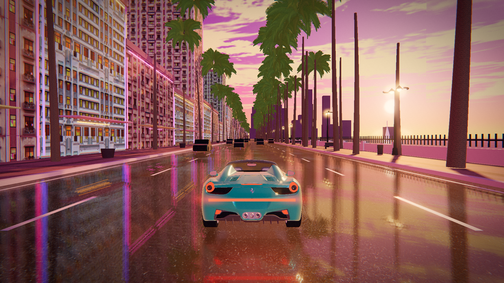

# VICE 306 — Miami Sunset

A playable **GTA-VI-style** Miami sunset driving scene that runs in the browser
(Three.js / WebGL2). No story, no missions — just Ocean Drive at golden hour, a
teal supercar, wet asphalt, palms and neon, built so you can compose and save
screenshots like the reference shot.

Everything you see is generated at runtime from **AI-generated textures**
(palm fronds, art-deco facades, wet asphalt, ocean, sand, clouds) plus
procedurally built geometry — no downloaded scene.



---

## Run it

```bash
npm install
npm run dev        # http://localhost:5173
# or
npm run build && npm run preview   # http://localhost:4173
```

Quality switch: `?q=low` (disables shadow maps, smaller reflection target),
`?refl=off` (turns the planar road reflection off, useful on weak GPUs).

## Controls

| key | action |
| --- | --- |
| `W A S D` / arrows | drive |
| `SHIFT` | boost |
| `P` | photo mode (drag to look, `WASD` to fly, `Space`/`Q` up & down) |
| `H` | toggle HUD (minimap + speedometer) |
| `ENTER` | capture a PNG screenshot (downloads `vice306-miami-*.png`) |

Photo mode keeps the current view, lets you fly the camera freely and then
saves exactly what the canvas shows (bloom + grade included).

## What's in the scene

* **Wet road with real planar reflection** (`src/wetroad.js`) — a mirror pass
  with oblique-clip projection (math adapted from three.js `Reflector`) feeding a
  custom asphalt shader: AI asphalt texture + AI normal map, puddle noise,
  distance blur, Fresnel and sun glitter.
* **Sunset sky** (`src/sky.js`) — shader gradient, sun disc + bloom, back-lit
  AI cloud band with slow drift, haze on the horizon.
* **Art-deco hotel row** (`src/world.js`) — instanced/merged facades using two AI
  elevation textures with a derived emissive mask, plus neon tubes, awnings,
  parapets and rooftop lines.
* **Palms** — procedural bent trunks with ringed AI bark and 4 rings of
  alpha-cut AI fronds per crown, instanced in irregular rows.
* **Ocean** — animated shader with ripple layers, Fresnel sky reflection and a
  narrow sunset glitter path, plus beach, balustrade, promenade props, lamps.
* **Traffic** — low-poly cars cruising the boulevard with tail-light glow.
* **Player car** — the three.js Ferrari 599 GTO sample asset, repainted teal,
  tail-light bar + glow, spinning wheels.
* **Post FX** (`src/postfx.js`) — UnrealBloom (HDR, so only true highlights
  bloom), ACES tone mapping, chromatic aberration, split-tone grade, vignette,
  film grain.
* **HUD** (`src/hud.js`) — GTA-style rotating GPS minimap and a speedometer.

## AI-generated textures

Source images live in `public/textures_src/` and are post-processed by
`tools/prepare-textures.mjs` into `public/textures/`:

| source | output | processing |
| --- | --- | --- |
| `asphalt.jpg` | `asphalt.jpg`, `asphalt_normal.jpg` | resize, derive normal map |
| `sidewalk.jpg` | `sidewalk.jpg`, `sidewalk_normal.jpg` | resize, derive normal map |
| `facade_neon.jpg`, `facade_white.jpg` | facade maps + `*_emissive.jpg` | lit-window / neon mask extraction |
| `palm_frond.jpg` | `palm_frond.png` | level → black-keyed alpha → tight crop |
| `palm_bark.jpg` | `palm_bark.jpg` | resize |
| `ocean.jpg` | `ocean.jpg` | resize |
| `clouds.jpg` | `clouds.jpg` | resize |
| `sand_src.jpg` | `sand.jpg` | resize |
| — | `glow.png` | procedural radial glow sprite |

```bash
node tools/prepare-textures.mjs
```

## Tests / screenshots

`tools/screenshot.mjs` boots the built app in headless Chromium with WebGL
(SwiftShader), waits until the game reports ready, captures a set of viewpoints,
**fails on any console error**, and samples the frame rate:

```bash
npm run build && npm run preview     # in one shell
LD_LIBRARY_PATH=/path/to/chromium/libs node tools/screenshot.mjs
```

Results are written to `screenshots/` (`01-hero` … `06-rear-close`).

## Browser hooks (`window.__vice`)

The game exposes a small API used by the test harness — handy for making your
own shots:

```js
__vice.setCamera([x, y, z], [tx, ty, tz]);  // free camera
__vice.setHeroView();                       // reference composition
__vice.placeCar(x, z, yaw);
__vice.hud(false);                          // hide HUD
__vice.photoMode(true);
__vice.capture();                           // -> dataURL (also downloads)
```

## Credits

* [three.js](https://threejs.org) (MIT) — renderer, GLTFLoader, DRACO, post FX.
* `examples/models/gltf/ferrari.glb` from three.js — player car.
* All textures in `public/textures_src/` were generated for this project with an
  AI image model.
